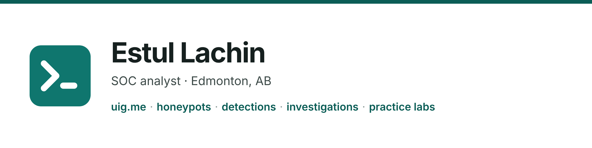

SOC analyst in Edmonton, AB. I run two decoy servers on the internet, detect what attackers do on them and
investigate each case the way a security operations team does. Everything is at **[uig.me](https://uig.me)**.

- SOC analyst: alert triage in Splunk and IBM QRadar, phishing analysis, incident reports
- Three and a half years of freelance IT support for small businesses: remote user support,
  network troubleshooting, websites and cloud-hosted services
- [CompTIA Security+](https://www.credly.com/badges/0ad03319-76a9-4370-ad02-18248eb24f2d/public_url) · [Google IT Support Professional Certificate](https://www.credly.com/badges/922b8039-3667-49e6-b933-8e15fd46b0fe/public_url) (verified on Credly)

## Start with one case

**[INC-001: a botnet broke into my server and planted a cryptominer](https://uig.me/honeypot/inc-001.html)**.
What the attackers did, what my alerts caught and missed, and why nothing got out.
More in the [incident reports](https://uig.me/incidents/).

## Honeypots

A hardened Cowrie SSH/Telnet honeypot on a VPS, and a real Debian server with a bait account and all outbound
traffic blocked. Attacks are mapped to MITRE ATT&CK, streamed to Microsoft Sentinel, published hourly without IP
addresses and summarized in weekly reports at
**[uig.me/honeypot](https://uig.me/honeypot/)** ([source](https://github.com/estul-lachin/honeypot)).

## Detections

18 Sigma rules (a vendor-neutral detection format) for the attacks the honeypot sees, each tested in CI against
attack and look-alike events, converted to Splunk SPL and KQL, and verified in both Splunk and Microsoft Sentinel,
where they run as analytics rules on the live honeypot feed. SOAR playbooks enrich, triage and escalate the
incidents they raise. Browse them at
**[uig.me/detections](https://uig.me/detections/)** ([source](https://github.com/estul-lachin/detections)).

## Investigations

Cases I investigated and the playbooks I use, with the same questions written in SPL, KQL and Wazuh's query
language, run on the same day of data and checked against each other, at
**[uig.me/investigations](https://uig.me/investigations/)** ([source](https://github.com/estul-lachin/investigations)).

## Practice labs

Every skill I learn becomes a small Docker lab with automated checks that I can reset and redo at any time.
The ones I have passed are listed at
**[uig.me/labs](https://uig.me/labs/)** ([source](https://github.com/estul-lachin/labs)).

## Contact

[hello@uig.me](mailto:hello@uig.me) · [uig.me](https://uig.me) · [LinkedIn](https://www.linkedin.com/in/estul-lachin) · [Résumé (PDF)](https://uig.me/Estul-Lachin-Resume.pdf)
