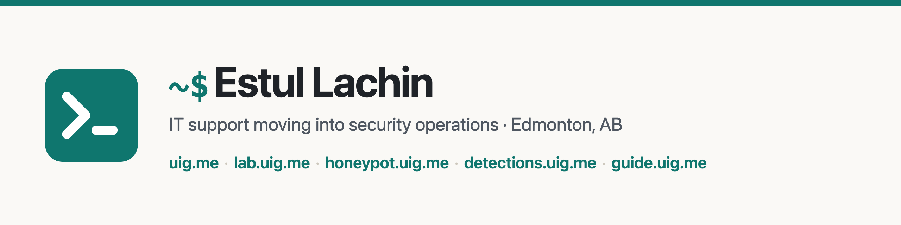

IT support technician moving into security operations, based in Edmonton, AB.
Everything I build is linked from **[uig.me](https://uig.me)**.

- Three and a half years of freelance IT support for small businesses: remote user support,
  network troubleshooting, websites and cloud-hosted services
- [CompTIA Security+](https://www.credly.com/badges/0ad03319-76a9-4370-ad02-18248eb24f2d/public_url) · [Google IT Support Professional Certificate](https://www.credly.com/badges/922b8039-3667-49e6-b933-8e15fd46b0fe/public_url) (verified on Credly)
- SOC analyst: alert triage in Splunk and IBM QRadar, incident reports

## Hands-on labs

Every skill I learn becomes a small Docker lab with automated checks that I can
reset and redo at any time. The ones I have passed are listed at
**[lab.uig.me](https://lab.uig.me)** ([source](https://github.com/estul-lachin/uig-lab)).

## Live honeypot

A hardened Cowrie SSH/Telnet honeypot on a VPS. Real attacks are mapped to MITRE ATT&CK,
streamed to Microsoft Sentinel, published hourly without IP addresses and summarized in weekly reports at
**[honeypot.uig.me](https://honeypot.uig.me)** ([source](https://github.com/estul-lachin/uig-honeypot)).
The raw logs also feed a local Splunk with AbuseIPDB reputation for every source and seven hand-written
[Splunk searches](https://github.com/estul-lachin/uig-honeypot/blob/main/docs/detections.md) that pick out the
sessions worth a closer look. These are separate from the Sigma rules below.

## Detection-as-code

17 Sigma rules (a vendor-neutral detection format) for the attacks the honeypot sees, each tested in CI against attack and look-alike events,
converted to Splunk SPL and KQL, and verified in both Splunk and Microsoft Sentinel, where they run as
hourly analytics rules on the live honeypot feed. Incidents they raise are enriched, triaged and escalated
automatically by SOAR playbooks. Browse them at
**[detections.uig.me](https://detections.uig.me)** ([source](https://github.com/estul-lachin/uig-detections)).

## SOC field guide

Evidence that I work in Splunk, Microsoft Sentinel and Wazuh, on the honeypot's real data.
The same investigation questions written in SPL, KQL and Wazuh's query language, run on the
same day of data and checked against each other, at
**[guide.uig.me](https://guide.uig.me)** ([source](https://github.com/estul-lachin/uig-guide)).

## Contact

[hello@uig.me](mailto:hello@uig.me) · [uig.me](https://uig.me) · [LinkedIn](https://www.linkedin.com/in/estul-lachin)
